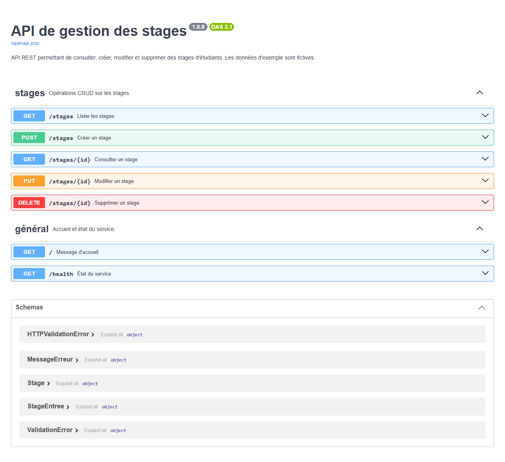
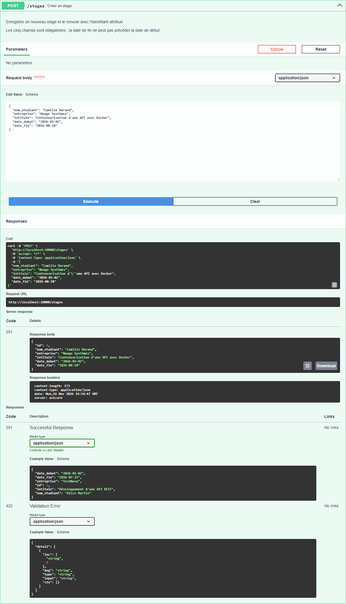
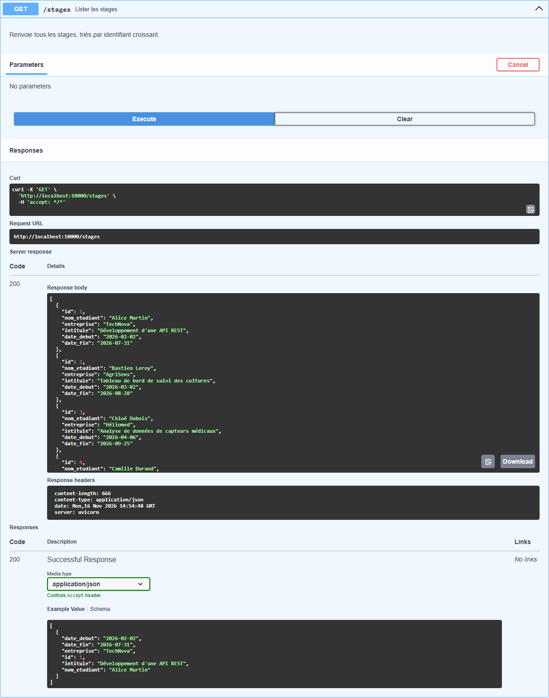
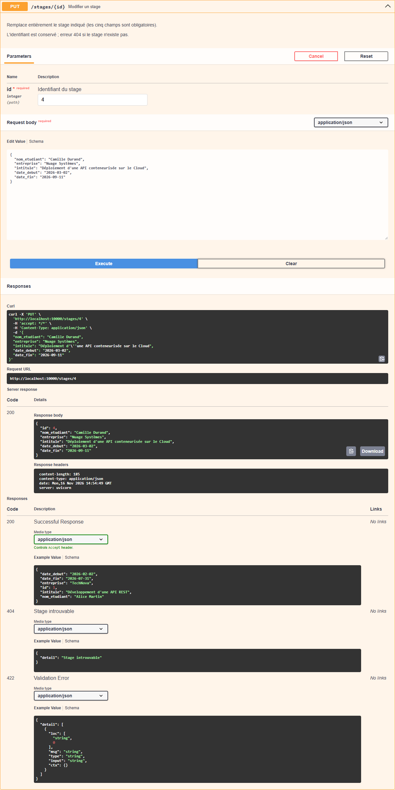
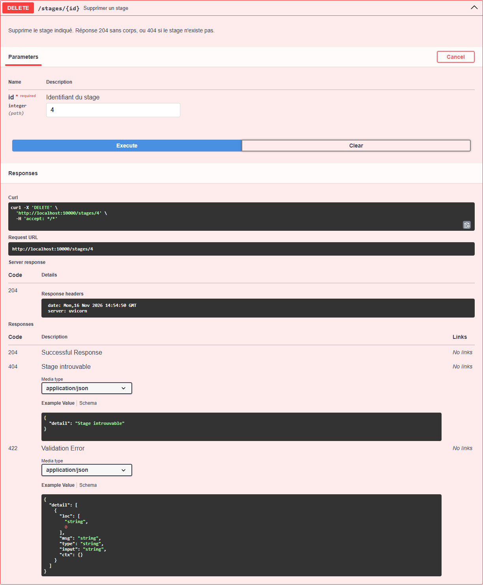
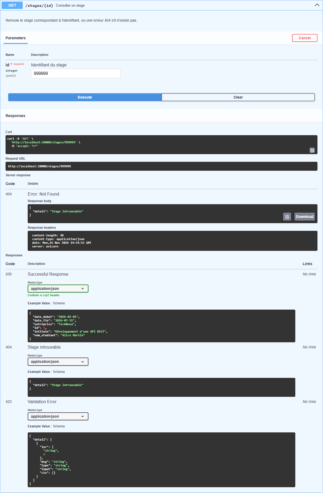
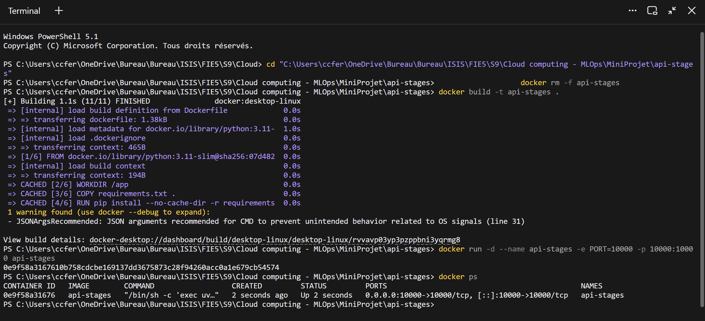
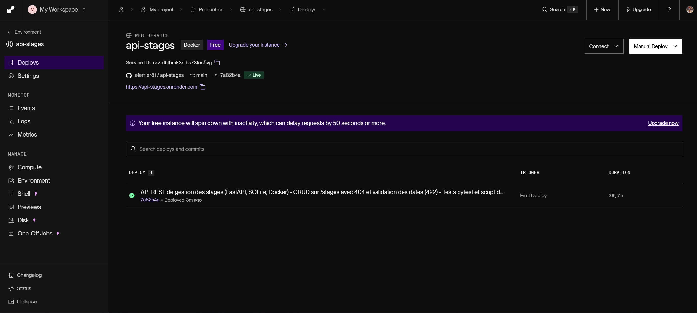
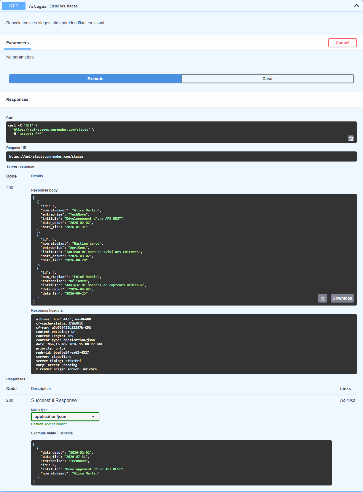

# API de gestion des stages

Mini-projet du cours « Cloud Computing, Microservices & API ». API REST qui permet de créer, consulter, modifier et supprimer les stages des étudiants d'une école d'ingénieurs. Elle est écrite en Python avec FastAPI, stocke ses données dans SQLite, est conteneurisée avec Docker et déployée sur Render (plan gratuit).

- **Groupe** : Enzo FERRIER, Ethan CABANES, Arthur PREVEL, Lucas LOPVET
- **URL publique** : https://api-stages.onrender.com (documentation Swagger : https://api-stages.onrender.com/docs)


## Endpoints

Un stage a la forme suivante (les champs sont toujours renvoyés dans cet ordre) :

```json
{
  "id": 1,
  "nom_etudiant": "Alice Martin",
  "entreprise": "TechNova",
  "intitule": "Développement d'une API REST",
  "date_debut": "2026-02-02",
  "date_fin": "2026-07-31"
}
```

| Méthode | Chemin | Corps de la requête | Succès | Erreurs |
|---|---|---|---|---|
| GET | `/` | aucun | 200, `{"message": "API de gestion des stages", "docs": "/docs"}` | |
| GET | `/health` | aucun | 200, `{"status": "ok"}` | |
| GET | `/stages` | aucun | 200, liste des stages triée par `id` | |
| GET | `/stages/{id}` | aucun | 200, le stage | 404 |
| POST | `/stages` | stage sans `id` (5 champs) | 201, le stage créé avec son `id` | 422 |
| PUT | `/stages/{id}` | stage sans `id` (5 champs) | 200, le stage modifié (remplacement complet) | 404, 422 |
| DELETE | `/stages/{id}` | aucun | 204, corps vide | 404 |

Règles de validation (corps de POST et PUT) :

- Les 5 champs `nom_etudiant`, `entreprise`, `intitule`, `date_debut`, `date_fin` sont obligatoires ; les champs inconnus sont ignorés.
- `nom_etudiant`, `entreprise`, `intitule` : chaînes non vides une fois les espaces de bord retirés, 200 caractères au maximum. Elles sont enregistrées sans ces espaces.
- `date_debut`, `date_fin` : format ISO `AAAA-MM-JJ`, avec `date_fin` postérieure ou égale à `date_debut`.
- Tout manquement renvoie 422 au format standard de FastAPI. Un `id` non entier dans le chemin renvoie aussi 422.

Stage inexistant : GET, PUT et DELETE sur `/stages/{id}` renvoient tous 404 avec le corps `{"detail": "Stage introuvable"}`.

### Exemple

Création d'un stage (données fictives) :

```http
POST /stages
Content-Type: application/json

{
  "nom_etudiant": "Lucas Bernard",
  "entreprise": "Entreprise Fictive SA",
  "intitule": "Mise en place d'une chaîne de déploiement",
  "date_debut": "2026-03-02",
  "date_fin": "2026-08-28"
}
```

Réponse `201 Created` (sur une base neuve, qui contient déjà les 3 stages d'exemple d'id 1 à 3) :

```json
{
  "id": 4,
  "nom_etudiant": "Lucas Bernard",
  "entreprise": "Entreprise Fictive SA",
  "intitule": "Mise en place d'une chaîne de déploiement",
  "date_debut": "2026-03-02",
  "date_fin": "2026-08-28"
}
```

Le même appel avec `"date_fin": "2026-01-15"` (antérieure à `date_debut`) renvoie 422. `GET /stages/999999` renvoie 404 et `{"detail": "Stage introuvable"}`.

### Documentation interactive

- Swagger UI : `/docs` (en local : http://localhost:10000/docs, en ligne : https://api-stages.onrender.com/docs)
- Schéma OpenAPI : `/openapi.json`

## Lancer le projet en local

Prérequis : Python 3.11.

```bash
python -m venv .venv
# Windows : .venv\Scripts\activate    Linux / macOS : source .venv/bin/activate
pip install -r requirements-dev.txt
uvicorn app.main:app --reload --port 10000
```

L'API répond sur http://localhost:10000. La base SQLite est créée au démarrage dans le fichier indiqué par la variable d'environnement `DATABASE_PATH` (par défaut `stages.db`) et reçoit 3 stages fictifs si elle est vide.

## Tests

Les tests demandés en partie 2 de l'énoncé ont été faits dans Swagger UI (`/docs`) : création, consultation de la liste, modification, suppression et stage inexistant. Les captures 02 à 06 en gardent la trace.

En complément :

- Tests automatisés : `pip install -r requirements-dev.txt` puis `pytest`. Chaque test part d'une base temporaire contenant les 3 stages d'exemple.
- Test de bout en bout contre une API qui tourne : `python scripts/smoke_test.py [BASE_URL]` (par défaut `http://localhost:10000`). Le script attend que `/health` réponde, enchaîne création, liste, lecture, modification, suppression, cas 404 et cas 422, affiche une ligne par étape et supprime ce qu'il a créé. Il s'utilise aussi contre l'API en ligne : `python scripts/smoke_test.py https://api-stages.onrender.com`.

## Lancer avec Docker

```bash
docker build -t api-stages .
docker run -d --name api-stages -e PORT=10000 -p 10000:10000 api-stages
```

La documentation Swagger est alors sur http://localhost:10000/docs. Pour arrêter et supprimer le conteneur : `docker stop api-stages` puis `docker rm api-stages`.

L'image part de `python:3.11-slim`, s'exécute avec un utilisateur non root et écoute sur le port donné par la variable `PORT` (10000 par défaut), comme l'attend Render.

## Déploiement sur Render

Déploiement manuel, selon les étapes de l'énoncé :

1. Déposer le code source du projet sur GitHub (dépôt public `api-stages`, branche `main`).
2. Créer un compte Render (https://render.com/).
3. Connecter le dépôt GitHub à Render.
4. Créer un Web Service en choisissant l'environnement Docker et le plan gratuit, avec ces valeurs :
   - Name : `api-stages`
   - Language : `Docker`
   - Branch : `main`
   - Region : `Frankfurt`
   - Instance Type : `Free`
   - Health Check Path : `/health` (dans les réglages avancés)
5. Lancer le déploiement.
6. Récupérer l'URL publique de l'API (voir en haut de ce document).
7. Tester les endpoints depuis un navigateur ou Postman, par exemple https://api-stages.onrender.com/docs et https://api-stages.onrender.com/stages.

Le fichier `render.yaml` décrit le même service (Docker, plan gratuit, Frankfurt, `/health`). Il est facultatif : la création manuelle ci-dessus ne le lit pas.

## Captures

Les captures 01 à 06 sont prises contre le conteneur local, 08 à 11 concernent l'API déployée. Toutes les données affichées sont fictives.

**01 - Swagger UI servi par le conteneur local (`http://localhost:10000/docs`)**



**02 - Création d'un stage dans Swagger UI : POST /stages, réponse 201**



**03 - Consultation de la liste : GET /stages, réponse 200**



**04 - Modification d'un stage : PUT /stages/{id}, réponse 200**



**05 - Suppression d'un stage : DELETE /stages/{id}, réponse 204**



**06 - Stage inexistant : GET /stages/{id}, réponse 404 « Stage introuvable »**



**07 - Terminal : construction de l'image et lancement du conteneur (sortie texte complète dans [captures/07-docker-build-run.txt](captures/07-docker-build-run.txt))**



**08 - Tableau de bord Render : service Docker, plan gratuit, statut « Live »**



**09 - Swagger UI sur l'URL publique (https://api-stages.onrender.com/docs)**


**10 - GET /stages sur l'URL publique**



**11 - Sortie de `smoke_test.py` contre l'URL publique, preuve du CRUD complet à distance : [captures/11-smoke-render.txt](captures/11-smoke-render.txt)**

## Limites

Ce projet est un exercice pédagogique :

- **Mise en veille** : sur le plan gratuit, Render met le service en veille après une période d'inactivité. Le premier appel qui suit est lent (environ une minute) le temps que le service redémarre.
- **Perte des données** : la base SQLite est un fichier dans le conteneur, dont le système de fichiers n'est pas persistant sur Render gratuit. Les données sont perdues à chaque redémarrage, réveil ou redéploiement, et l'API repart des 3 stages d'exemple.
- **Données fictives** : aucune donnée personnelle réelle n'est utilisée, ni dans les données d'exemple, ni dans les tests, ni dans les captures.
- **Hors périmètre** : pas d'authentification, pas de persistance durable de la base, pas de CI/CD.

## Structure du projet

```
app/                    application FastAPI (routes, accès SQLite, schémas Pydantic)
tests/                  tests pytest
scripts/smoke_test.py   test de bout en bout contre une URL
captures/               captures d'écran du rendu
Dockerfile              image Docker de l'API
render.yaml             description du service Render (facultatif)
requirements.txt        dépendances d'exécution
requirements-dev.txt    dépendances de test
```
